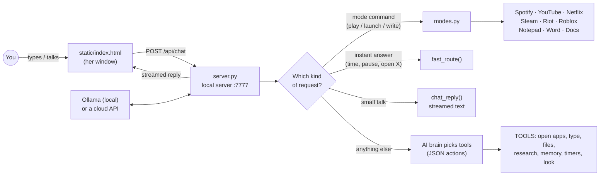

  <a href="#the-big-picture"><b>Big picture</b></a> ·
  <a href="#what-happens-when-you-talk-to-her">One request, start to finish</a> ·
  <a href="#file-by-file">File by file</a> ·
  <a href="#her-web-pages-static">Web pages</a> ·
  <a href="#data-files-she-creates">Data files</a> ·
  <a href="#design-decisions">Design decisions</a>
    <a href="#limitations">Limitations</a> ·
  <a href="docs/HOW_IT_WORKS.md">How it works</a>

<h1 align="center">How Capri works</h1>

A guided tour of every file in this repo: what it does, how the pieces talk to each other, and why things are built the way they are. 
For installing and using Capri, see the <a href="../README.md">README</a>. For every voice command, see <a href="GUIDE.md">GUIDE.md</a>.

---

## The big picture

Capri is one Python program (`server.py`) that runs two things at once:

1. **A tiny local web server** on `http://127.0.0.1:7777`. Her whole interface (the chat, the GIF of her face, the right-click menu) is a web page in `static/`. Only your own PC can reach it.
2. **Desktop windows** made with **PySide6 (Qt)**. Each window is a see-through, always-on-top browser (QtWebEngine) that shows one of those pages: her main window, the little desktop mate, the timer HUD, the autopilot overlay and the flatline screen.

Everything she *does* happens in Python behind that web page: talking to the AI brain, hearing you, opening apps, typing, playing music, launching games.

### The main parts at a glance

| Part | Files | Job |
|---|---|---|
| **Core app** | `server.py` | Web server, windows, tray icon, AI brain, voice in/out, wake word, PC-control tools |
| **Modes** | `modes.py`, `music.py`, `spotapi_play.py` | Music, Watching, Research, Homework, Gaming |
| **Extras** | `extras.py`, `i18n.py`, `providers.py` | Timers, memory, research, files, moods, languages, cloud AI brains |
| **Minecraft** | `autoplay.py`, `mc_vision.py`, `minecraft_setup.py` | The no-mod autopilot that plays by reading the screen |
| **Streaming** | `stream_live.py`, `stream_setup.py` | TikTok LIVE chat, voting, OBS scene builder |
| **Clips** | `clipper.py`, `clip_video_worker.py`, `clip_audio_worker.py` | Keeps the last 30 seconds of screen and sound in memory |
| **Staying alive** | `launcher.py`, `check.py`, `update.bat` | Auto-restart, safe mode, readiness check, updating |
| **Installer** | `installer/`, `build_installer.bat` | Builds `CapriSetup.exe` in 16 languages |
| **Interface** | `static/` | Her web pages, GIFs, sounds, fonts and the beep voice |

---

## What happens when you talk to her

Here's the full journey of one message, for example *"play i get around by 2pac"* while she's in music mode.

1. **You type it or say it.**
   - Typed: `static/index.html` sends it to `POST /api/chat`.
   - Spoken: the page records your voice, converts it to 16 kHz audio and sends it to `POST /api/stt`. `server.py` turns it into text with **faster-whisper** (on your PC, no cloud), then it goes to `/api/chat` like typed text.
   - Wake word: separately, `wake_loop()` listens in the background for "Hey Capri" / "Capri" / "Call" and opens a hands-free call when it hears it.
2. **`run_turn_stream()` in `server.py` decides what kind of request it is**, cheapest first:
   - **Special commands:** stop, language switching, "use groq", Minecraft autopilot, stream mode, flatline/power commands, clips, timers, memory.
   - **Mode commands:** `modes.route()` checks the current mode. In music mode, "play …" goes straight to `modes.music_play()`. No AI call needed, so it's instant.
   - **Instant answers:** `fast_route()` handles greetings, the time and date, pause/next/volume, "open spotify" and Google searches with no AI at all.
   - **Small talk:** short messages without action words go to `chat_reply()`, which streams plain text from the brain (fastest possible reply).
   - **Everything else:** the brain gets her full prompt (`SYSTEM`) plus a tool list and answers in JSON: `{"say": "...", "mood": "...", "actions": [{"tool": "...", ...}]}`. `exec_action()` runs the tools. Tools whose result she needs for her answer (looking at the screen, files, research, memory) run first; everything else runs in the background so she never makes you wait.
3. **Her reply streams back** line by line (`{"t":"say"}` pieces, `{"t":"act"}` action notes, then `{"t":"done"}`). The page types it out letter by letter with the beep voice from `static/capri_voice.js`, or plays a spoken voice from `POST /api/tts`.
4. **Her face changes** with her mood (talking, working, hyped, alert, dormant) by switching GIFs, with a "REWIRING" static effect between them.

---

## File by file

### `server.py`: the heart of Capri

The biggest file (about 2,000 lines). Everything starts here.

**Start-up and safety**
- Turns on `faulthandler`, so even a hard native crash leaves a stack trace in `capri_crash.txt`.
- `--safe` (set by `launcher.py` after repeated crashes) switches risky extras off.
- `pyautogui.FAILSAFE`: slamming the mouse into a screen corner stops any automation.

**The AI brain**
- `pick_model()` chooses the fastest good Ollama model you have (prefers small 3B models; `CAPRI_MODEL` overrides it).
- `_fast_brain()`: if you only have a big, slow model, it downloads `llama3.2:3b` in the background and switches to it.
- `_prime()` loads the model at start-up with her long prompt, so the first reply is quick.
- Every request uses the **same** context size (`CAPRI_CTX`, 8192) and `keep_alive=-1`. Ollama reloads the whole model whenever the context size changes, so keeping it fixed keeps her fast.
- `ollama_watchdog()` / `ensure_ollama()` restart Ollama if it closes or crashes.
- `llm_stream()` / `ollama_chat()` send requests either to Ollama or, if you picked a cloud brain, through `providers.py`.

**Her personality**
- `SYSTEM` is her character prompt (Cyberpunk slang, cocky and playful) plus the list of tools she can call and strict JSON rules. `lore/lore.txt` is added to it, so she answers "who are you?" in character.

**Tools she can use** (the `TOOLS` table)

| Tool | What it does |
|---|---|
| `open_url`, `search`, `youtube` | Open a website, Google something, find and play the top YouTube result |
| `open_app` | Start any app: built-in links (`steam://`, `spotify:`...), then Start Menu shortcuts (`_start_menu_find`) |
| `spotify` | Play a song: SpotAPI first, the official Spotify API second, Spotify search as a fallback |
| `type_here`, `search_here`, `write_essay` | Type into the window you were using, or into its search box |
| `press`, `click`, `scroll`, `media`, `focus_window` | Keyboard shortcuts, clicks, media keys, switching windows |
| `look` | Screenshot + vision model: answers "what's on my screen?" |
| `find_file`, `open_file`, `ask_file`, `fix_file` | Find files in your user folder, open them, answer questions about them, fix code |
| `create_file`, `edit_file`, `replace_in_file`, `undo_edit`, `make_folder`, `list_dir` | Safe file editing (from `extras.py`, always with backups) |
| `research`, `remember`, `forget`, `remind`, `timer`, `call_me` | Research, long-term memory, timers and reminders |

**Typing for you**
- `_send_unicode()` types with Windows `SendInput` Unicode keystrokes, so it works on **any keyboard layout** (AZERTY, QWERTZ, Arabic...).
- `type_into()` types into **one specific window**. If you click somewhere else it pauses and waits up to a minute for you to come back, so it never types into the wrong app. If you don't come back, the rest goes to the clipboard.
- `clip_set()` puts text on the clipboard and reads it back to make sure it's really there.
- `track_loop()` remembers the last window **you** used (not hers), so "type this" goes where you were looking.

**Hearing and speaking**
- `stt_pcm()` / `stt()`: local speech-to-text with faster-whisper (English-only `.en` models for English, multilingual models otherwise).
- `wake_loop()`, `wake_match()`, `wake_command()`: the wake word. *"Hey Capri, play looping the rooms"* answers the call **and** runs the command.
- `tts()`: her spoken voices. `voicebox` (your cloned voice through the Voicebox app), `piper` (local voice) or `api` (OpenAI / ElevenLabs via `api_tts()`). The default beep voice is made in the browser instead (see `capri_voice.js`).

**Windows and the tray** (Qt, at the bottom of the file)
- **Main window**: frameless, see-through, always on top, showing `index.html`. A `Bridge` of Qt signals lets the web server safely move or resize windows from other threads.
- **Desktop mate** (`mate.html`): a small Capri who teleports to the top edge of your windows (`choose_perch()`, `mate_loop()`) and picks up calls.
- **Timer HUD** (`timer.html`), **autopilot overlay** (`takeover.html`), **flatline screen** (`flatline.html`).
- **Tray icon** menu: show her, toggle the mate, save a clip, open clips, quit.
- **Cursor watch**: a 120 ms timer checks whether your mouse is over one of her windows and tells that page to pause its animations. Windows makes the pointer blink when a see-through window redraws underneath it.
- The page cache is cleared at start-up and every response is sent `no-store`, so an update always shows straight away.

**Power and flatline**
- `power_intent()` recognises "power off", "reset my pc" and "show the flatline screen". `start_flatline()` plays the Cyberpunk flatline sequence. Its menu option decides what happens: **CONTINUE** (just the show), **LOAD LAST CHECKPOINT** (restart) or **EXIT TO MAIN MENU** (shut down).

**The local API (`class H`)**: every route the web pages use. Other apps on your PC can use it too.

| Route | Used for |
|---|---|
| `POST /api/chat` | Send her a message; the reply streams back as JSON lines |
| `POST /api/stt` | Speech to text |
| `POST /api/tts` · `GET /api/voices` · `GET /api/voicestatus` | Her spoken voice and which voices are available |
| `GET/POST /api/settings` | Read or change settings (mode, defaults, voice, language...) |
| `GET/POST /api/keys` | API KEYS menu: save, test or remove keys, pick the brain |
| `GET /api/events` | The page polls this for things that happen in the background (timers ringing, actions finishing) |
| `POST /api/stop` | Stop everything she's doing |
| `POST /api/clip` | Save a clip / open the clips folder |
| `POST /api/flatline` | The flatline page reports which option lit up |
| `GET /api/stream` · `POST /api/stream/chat` | Stream mode status and test chat |
| `GET /api/takeover` · `POST /api/mcsetup` | Minecraft autopilot status / setup |
| `GET /api/health` · `/api/timers` · `/api/languages` · `/api/providers` | Status info for the menu and HUDs |
| `POST /api/fit` · `/api/move` · `/api/menu` · `/api/mate/...` · `/api/callstate` | Window size and position, the menu panel, the mate, call state |
| `POST /api/tr` | Translate one of her fixed lines into your language |

---

### `modes.py`: her five modes

Each mode has a **default app** (right-click > the mode's row). You can always override it in the sentence: *"play pain 1993 by drake **on youtube**"*.

- **Settings**: `DEFAULTS`, `_load()`, `save()` and `setv()` manage `capri_settings.json`. The installer's language choice (`install_language.json`) is read once at first start.
- **`route()`**: the mode-aware command router. It's called before the AI, so mode commands are instant.
- **Music**: `music_play()` hands smart requests to `music.py` and plain ones to Spotify / YouTube / YouTube Music / Apple Music / SoundCloud. `split_service()` spots "on youtube" in a sentence.
- **Watching**: `watch_play()` opens a show on Netflix, Disney+, Prime Video, Twitch or Crunchyroll; `latest_from_channel()` plays a YouTuber's newest upload.
- **Gaming**: `launch_game()` tries your default launcher first, then the others, then the Start Menu.
  - **Steam**: reads your Steam library files (`steam_games()`, `find_steam_game()` with fuzzy matching) and runs `steam://rungameid/<id>`.
  - **Riot**: `_riot_exe()` finds the Riot Client from `RiotClientInstalls.json` and launches the game. Then `_press_play()` watches for the game process; if it hasn't started, it reads the Riot Client window with OCR, finds the **PLAY** button (in many languages) and clicks it, up to 3 times.
  - **Epic**: launches through `com.epicgames.launcher://`.
  - **Roblox**: `_roblox_experience()` finds a game with Roblox's own search API (with typo fixes like "braintrot" → "brainrot"), then `_roblox_join()` joins it with `roblox://experiences/start?placeId=…`. If that can't open, it opens the game's roblox.com page instead.
  - **Minecraft**: asks Java or Bedrock, then opens the right launcher.
- **Homework**: `homework_essay()` writes and types at the same time.
  - The essay is generated in a background thread **while** `_open_target()` opens Notepad, Word or a new Google Doc. It waits until that exact window is ready (and closes Notepad's stale-file pop-ups).
  - `kind_of()` picks the writer: **essay**, **creative** (stories, poems, letters) or **code** (programming homework gets real, commented code). `clean_essay()` / `clean_code()` strip AI chatter and markdown.
  - Every piece is also saved by `_backup()` to *Documents\Capri Homework*, so nothing is ever lost.
- **Research**: `deep_research()` plans several searches (`_plan()`), reads Wikipedia and the top web pages (`_page_text()`), then writes precise bullet points and opens the best page.

### `music.py`: smart music requests

Understands requests like *"play hutchers newest song"*, *"the latest album by drake"*, *"a random song from my liked songs"* and *"my gym playlist"*.
- `parse()` uses rules first (fast); `parse_llm()` asks the brain for unusual phrasing or other languages.
- Fuzzy artist matching (`_name_variants()`, `_sim()`): "hutchers" finds **Hutcher**.
- Spotify functions (`spotify_newest()`, `spotify_liked()`, `spotify_playlist()`...) and YouTube / YouTube Music versions (`youtube_newest()`, `youtube_liked()` uses your signed-in browser).

### `spotapi_play.py`: Spotify without a developer account

Plays Spotify using **SpotAPI**, which talks to Spotify like the web player does, with your logged-in `sp_dc` cookie.
- `_Connect` is Capri's own Spotify Connect remote, built on SpotAPI's websocket session. SpotAPI's built-in player broke on newer Spotify versions, so she sends the play commands herself.
- `track()`, `newest()`, `artist()`, `album()`, `liked()`, `playlist()` and `control()` (pause, resume, next, previous).
- The cookie is saved in `spotapi_session.json`, which is **git-ignored**.

### `spotify_setup.py`

One-time Spotify setup. **Option 1** (easy): paste your `sp_dc` cookie and it tests SpotAPI. **Option 2**: the official Web API (Spotify Premium plus a free developer app); the script tells you exactly what to click.

### `extras.py`: timers, memory, files, research, moods

- **Timers and reminders**: `parse_reminder()` understands *"set a timer for 10 minutes"* and *"remind me to call mom at 6"*. `reminder_loop()` runs in the background, even when she's hidden in the tray, and calls you when one is due. Saved in `reminders.json`.
- **Long-term memory**: `remember()`, `forget()` and `memory_context()` (adds the relevant memories to each request). `learn_from()` picks up facts you mention. Saved in `capri_memory.json`.
- **Quick research**: `research()` with Wikipedia and DuckDuckGo (used outside research mode).
- **Safe file editing**: `create_file()`, `edit_file()`, `replace_in_file()`, `undo_edit()`. She only touches files inside your user folder, always makes a backup in `capri_backups/` first, edits long files in chunks, and `_validate()` refuses to save an edit that would break the file (for example a Python syntax error).
- **Moods**: `detect_feeling()` reads how you're feeling. `mood_pop()` sometimes opens a reaction image, but never while she's busy (see `_mood_pop_safe()` in `server.py`).

### `providers.py`: bring your own AI

- Her brain can be **local Ollama** (default), anything **OpenAI-compatible** (OpenAI, Groq, OpenRouter, LM Studio, DeepSeek...) or **Anthropic Claude**, configured in `providers.json`.
- `openai_stream()` / `anthropic_stream()` stream replies from those APIs, including images for the vision tool.
- **API KEYS menu backend**: `keys_status()` (shows only hints like `gsk...9f2a`, never the key), `save_key()` (writes to `providers.json` or `voice_api.json`), `check_key()` (a quick "does this key work?" call) and `set_voice_service()`.
- `_key()` reads a key from the file or from an environment variable.

### `i18n.py`: 16 languages

- The installer's language, or right-click > LANGUAGE, decides what she speaks.
- `reply_rule()` tells the brain to always answer in your language while keeping her slang (choom, preem, delta...).
- `tr()` / `prewarm()` translate her fixed lines once with the brain and cache them in `capri_translations.json`, so they stay instant.
- `whisper_lang()` / `whisper_model()` pick the speech model for your language; `piper_voices()` lists Piper voices per language; `language_command()` understands *"speak French"*.

### `autoplay.py`: Minecraft autopilot commands

- `parse()` turns sentences into skills: *"get 20 logs"* → `skill:chop_wood:20`, *"find diamonds"* → `skill:find_ore:diamond`. `parse_llm()` handles anything the rules miss.
- `start()` / `stop()` / `handle()` / `status()` control the run and drive `takeover.html` (the neon autopilot frame).
- `hotkey_loop()`: **F8** always stops her.

### `mc_vision.py`: the no-mod Minecraft brain

She plays **by looking at the screen**, with no mods.
- **How she sees**: `ocr_lines()` reads Minecraft's F3 debug screen with Windows' built-in OCR (RapidOCR as a fallback). `parse_debug()` turns it into her position, where she's looking, and **exactly which block or mob is under the crosshair**.
- **Colour vision**: `find_tree()` finds tree trunks (bark with leaves above), `find_color()` finds ores, `danger()` spots lava, `water_ahead()` spots water.
- **How she moves**: `Input` sends keyboard scan codes and mouse movement with `SendInput`. **Every single key and mouse event first checks that Minecraft is the active window**; if it isn't, she freezes and releases everything (`Unfocused`). `deg_per_pixel()` works out camera turning from your mouse sensitivity.
- **Skills** (`Player`): chop wood, mine, find ores at the right height, explore, fight, eat, build a shelter, pillar up, and "play for me" (a loop of all of them). `Runner` runs them in the background.
- `ocr_words()`, `window_rect()` and `click_screen()` are also used by gaming mode to find and click the Riot Client's PLAY button.
- `python mc_vision.py --test` prints what she can see.

### `minecraft_setup.py`

One-time setup: installs the Windows OCR packages and turns off "pause on lost focus" in Minecraft's `options.txt`, so the game keeps running while she plays.

### `stream_live.py` and `stream_setup.py`: TikTok LIVE

- `stream_live.py` reads your LIVE chat with **TikTokLive**. Viewers vote with `!wood`, `!diamonds`, `!build`... (`viewer_command()`). Only safe Minecraft actions can ever get through, never PC commands. She answers chat in character, thanks gifts and follows, and hides chat messages with rude words or links (`ok_to_show()`).
- `stream_setup.py` (double-click `stream_setup.bat`) installs OBS and TikTokLive if needed, then builds the **Capri Live** OBS scene collection (landscape and vertical) with Minecraft, her overlay, chat and vote bars.

### `clipper.py`, `clip_video_worker.py`, `clip_audio_worker.py`: "clip that"

- `clipper.py` keeps the **last 30 seconds** of your screen (and system sound) **in memory only**. Nothing is written to disk until you say "clip". It then encodes an MP4 with the ffmpeg bundled in `imageio-ffmpeg`.
- Screen capture runs in `clip_video_worker.py` and sound capture in `clip_audio_worker.py`, each as a **separate process**. Windows' screen capture can crash when the screen changes underneath it (for example Win+Shift+S), and some audio drivers crash too; this way only the helper dies, and `clipper.py` restarts it.

### `launcher.py`: keeps her alive

Starts `server.py` and restarts it if it crashes, logging what happened. After 3 crashes in 2 minutes it restarts her in **safe mode** (clip buffer and desktop mate off). It also copies the crash trace into `capri_log.txt`.

### `check.py`

The readiness check (Start Menu > Capri check): Python packages, Ollama and models, microphone, Spotify setup, Word, your Steam library. Each problem comes with the fix.

### `transcribe_lore.py`

Optional: turns an audio clip into a draft bio for her lore, all locally. Her real lore is `lore/lore.txt`.

### Batch files

| File | What it does |
|---|---|
| `run.bat` | Starts Capri (uses her own `venv` if the installer made one) |
| `run_tray.bat` | Starts her hidden in the tray |
| `run_mate.bat` | Starts her with the desktop mate |
| `update.bat` | Installs any new packages after you update the code |
| `build_installer.bat` | Builds `CapriSetup.exe` (installs Inno Setup with `winget` if needed) |
| `build_exe.bat` | Optional: packs her into a single `CAPRI.exe` with PyInstaller |
| `stream_setup.bat` | Runs `stream_setup.py` |

### `installer/`: the Windows installer

- `Capri.iss` is the **Inno Setup** script. It installs to `%LOCALAPPDATA%\Capri` (no admin needed), installs Python and Ollama only if they're missing, creates Start Menu shortcuts (Capri, Capri check, Repair, Uninstall), and never packs your private files (keys, cookies, memory, logs).
- `lang/*.isl`: the installer's text in **16 languages**. The language you pick there becomes Capri's language.
- `postinstall.py` runs after the files are copied and shows its progress in a console window: a private Python environment with her packages, the AI model, the speech model and a Piper voice in your language. It's safe to run again (Start Menu > Repair), because every step skips what's already done.

### `tests/test_mc_vision.py`

Offline tests for the Minecraft vision: reading F3 text (including OCR mistakes like `XY2` for `XYZ`), finding trees, ores and lava in generated test images. Run with `python tests/test_mc_vision.py` or `python -m pytest tests`.

### `lore/lore.txt`

Her backstory and personality: a personality construct riding shotgun in your PC. It's added to her prompt so she stays in character.

---

## Her web pages (`static/`)

| File | What it is |
|---|---|
| `index.html` | Her main window: the chat, her animated face, the mic and hang-up buttons, the call screen, and the full right-click config menu (modes, default apps, voice, API keys, language, size, clips, system). It also does voice recording and voice-activity detection for hands-free calls. |
| `capri_voice.js` | **The beep voice.** A small synth (square wave plus an octave saw) that blips on every letter as her words type out, moving around a musical scale so it sounds like speech. Questions rise in pitch, and her mood shifts the tone. It reuses one audio graph instead of making new sound generators for each letter, which kept crashing the built-in browser. |
| `mate.html` | The desktop mate: a small vector Capri drawn and animated in SVG, with glitch-teleport effects and a speech bubble. |
| `flatline.html` | The full-screen Cyberpunk flatline sequence (CRITICAL SYSTEM FAILURE → FLATLINED → the menu) with `flatline_cp.mp3` and `flatline_skull.png`. |
| `stream.html` | The stream overlay: her GIF, live chat, the vote bars, and her replies in the bottom bar. |
| `obs_overlay.html`, `obs_overlay_vertical.html` | Small loaders OBS points at. They keep retrying until Capri is running, then show `stream.html`. |
| `takeover.html` | The neon frame and HUD shown while she controls Minecraft. |
| `timer.html` | The countdown HUD for running timers and reminders. |
| `gif*.gif`, `capri_*.gif` | Her faces for each mood. |
| `ringtone.mp3` | The ringtone when she calls you. |
| `fonts/`, `icons/` | The Rajdhani font, and the mic and hang-up icons. |

---

## Data files she creates

All of these are created on **your** PC and are listed in `.gitignore`, so they never end up on GitHub.

| File | What's in it |
|---|---|
| `capri_settings.json` | Your menu choices: mode, default apps, voice, language, size... |
| `capri_memory.json` | Things she remembers about you |
| `reminders.json` | Upcoming timers and reminders |
| `capri_translations.json` | Cached translations of her fixed lines |
| `providers.json` | Cloud AI brains and their API keys |
| `voice_api.json` | API voice settings and keys |
| `spotapi_session.json`, `spotify.json`, `.spotify_cache` | Spotify login (treat like passwords) |
| `mc_vision.json` | Your Minecraft hotbar slots |
| `capri_log.txt`, `capri_crash.txt` | Her log and crash traces |
| `capri_backups/` | Backups made before every file edit |
| `Documents\Capri Homework\` | A copy of every piece of homework |
| `Videos\Capri Clips\` | Your saved clips |

---

## Design decisions

- **Rules first, AI second.** Common commands (play, launch, write, pause, the time) are matched with fast rules before the AI is asked. That makes them instant and reliable even on a slow PC; the AI handles everything unusual.
- **Never type into the wrong window.** Typing, the Minecraft autopilot and button-clicking all check which window is in front before every action, and pause if you click away.
- **Risky things run in their own process.** Screen capture and audio capture can crash on some PCs, so they live in helper processes. `launcher.py` restarts the main app if something native crashes anyway.
- **Private by default.** The brain, speech recognition and the beep voice all run locally. Cloud brains and voices are opt-in, and keys never leave your PC or show up in logs.
- **Keep the brain warm.** One context size and `keep_alive=-1` stop Ollama reloading the model, which is the biggest single speed win.
- **Nothing is lost.** Homework is saved to a file, file edits are backed up first, and clips stay in memory until you ask for them.
