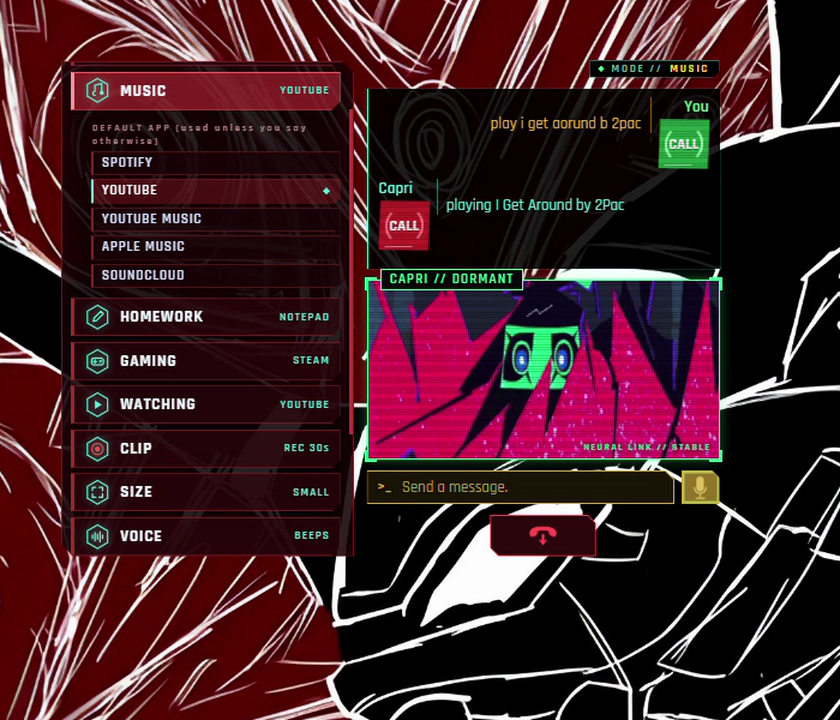
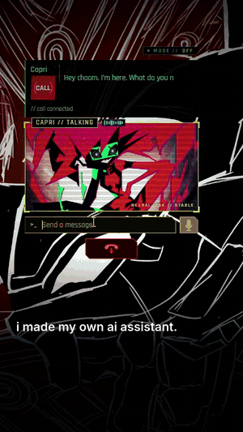
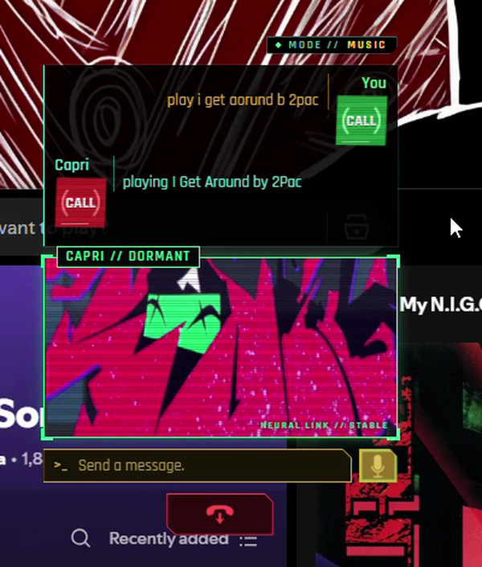
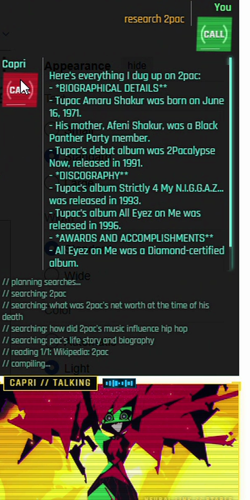

<p align="center">
  <a href="#how-to-install-and-run"><b>How to install and run</b></a> ·
  <a href="#features">Features</a> ·
  <a href="#things-to-say">Things to say</a> ·
  <a href="#troubleshooting">Troubleshooting</a> ·
  <a href="#limitations">Limitations</a> .
  <a href="docs/HOW_IT_WORKS.md">How it works</a>
</p>

<h1 align="center">Capri</h1>

<p align="center">
  
  
  
  
</p>

<p align="center">
A Cyberpunk-style AI assistant for Windows that I made in Python. She lives on your desktop, talks to you, and actually runs your PC:
she plays your music, puts on shows, researches anything, writes your homework into Notepad / Word / Google Docs, launches your games
(and presses PLAY for you), and can even play Minecraft by looking at the screen. Her brain runs on your own PC with Ollama, so it's free and private.
</p>

<p align="center">
  
</p>

<p align="center">
  
  &nbsp;&nbsp;
  
  &nbsp;&nbsp;
  
</p>

> A personality construct riding shotgun in your PC: cocky, funny, a little dangerous. Say **"Hey Capri"**.

---

## Features

### Five modes (right-click her > MODE)

| Mode | Say something like | What she does |
|---|---|---|
| **Music** | "play i get around by 2pac" · "play hutchers newest song" · "play a random song from my liked songs" | Finds it and plays it on **Spotify**, YouTube or YouTube Music |
| **Watching** | "play steel ball run" · "play westjett's newest vid" | Opens the show on **Netflix** / Disney+ / Prime / Twitch, or plays a YouTuber's newest upload |
| **Research** | "research 2pac" | Plans searches, reads the web and Wikipedia, gives you the key facts and opens the best page |
| **Homework** | "write a 500 word GCSE style essay on Macbeth in notepad" · "do my homework on print in python" | Opens **Notepad / Word / Google Docs** and types it live (essays, stories, code). Every piece is also saved to *Documents\\Capri Homework* |
| **Gaming** | "launch valorant" · "open roblox and play steal a brainrot" · "play for me" (Minecraft) | Launches games from **Steam, Riot, Epic, Roblox** and the Start Menu, presses **PLAY** in the Riot Client, joins Roblox experiences directly |

### Everything else

| | |
|---|---|
| **Voice + chat** | "Hey Capri" wake word, hands-free calls, typed chat. Local speech recognition (faster-whisper). 16 languages: the installer's language is the language she speaks. |
| **Her voice** | **Capri beeps** by default (an RPG-style blip for every letter), or **Piper**, **Voicebox** (your own cloned voice) or an **API voice** (OpenAI / ElevenLabs). |
| **Minecraft autopilot** | No mods. She reads the F3 screen and scans colours, then plays with your keyboard and mouse: chop wood, mine, find ores, explore, fight, eat, build. |
| **PC control** | Open apps, search, type where you're looking, edit files (with undo), timers that call you back, memory, clips of the last 30 seconds. |
| **API keys menu** | Paste an OpenAI / Groq / OpenRouter / Claude / ElevenLabs key in the menu to use a cloud brain or voice. Keys never leave your PC. |
| **Flatline screen** | "show the flatline screen", "power off my PC" or "reset my PC" plays a Cyberpunk flatline sequence. |
| **Desktop mate** | A small Capri who sits on top of your windows and picks up your calls. |
| **Local API** | Other apps on your PC can talk to her at `http://127.0.0.1:7777` (see [Local API](#local-api)). |
| **Robust** | Auto-restart launcher, safe mode, crash recorder, screen and sound capture run in separate crash-safe helpers. |

---

## How to install and run

### Requirements

| | Minimum | Recommended |
|---|---|---|
| OS | Windows 10 (64-bit) | Windows 11 |
| RAM | 8 GB | 16 GB |
| Disk | ~6 GB free | 10 GB free (room for a vision model) |
| GPU | none (runs on CPU) | any NVIDIA/AMD GPU with 4 GB+ VRAM, so replies are much faster |
| Python | 3.10 to 3.13 | 3.12 or 3.13 |
| Mic | any (needed for voice) | a headset (better wake-word accuracy) |

The installer downloads Python, Ollama, the AI model, the speech model and a voice for you, about 3 GB in total.

### Option A: the installer (recommended)

#### Step 1: get the installer

- **If a release is published:** go to this repo's **Releases** page (right side of the GitHub page) and download `CapriSetup.exe`.
- **If not, build it yourself (2 minutes):**
  1. Click the green **Code** button > **Download ZIP**, then extract it anywhere (for example `Downloads\capri`).
  2. Double-click **`build_installer.bat`**. It installs Inno Setup automatically (through `winget`) if you don't have it, then builds the installer.
  3. When it finishes, a folder opens: `installer\Output\CapriSetup.exe`.

#### Step 2: run it

1. Double-click **`CapriSetup.exe`**. If Windows shows *"Windows protected your PC"*, click **More info**, then **Run anyway**. The file isn't code-signed, which is normal for open-source projects.
2. **Pick your language** in the first window. This is important: **it becomes the language Capri speaks and understands**.
3. Click through the pages. On the **Components** page you can untick extras you don't want:
   - **AI brain (Ollama + model)**: required unless you'll use a cloud AI.
   - **Speech recognition**: needed for voice.
   - **Voice**: lets her talk back.
   - **Minecraft autopilot setup**: installs the OCR packages and turns off "pause on lost focus".
   - **Spotify setup**: opens the Spotify helper at the end.
4. Optional tasks: **Desktop shortcut** and **Start with Windows** (starts her in the tray).
5. Click **Install**. Files are copied to `%LOCALAPPDATA%\Capri` (no admin rights needed), then:
   - Python is installed **only if** you don't already have 3.10 to 3.13;
   - Ollama is installed **only if** it's missing;
   - a black **CAPRI // SETUP** window opens and downloads her packages, AI brain, speech model and voice. **This takes 5 to 20 minutes** depending on your internet. Leave it open until it says **"Capri is ready."**, then press Enter.
6. Tick **Launch Capri** and click **Finish**.

#### Step 3: check everything

Start Menu > **Capri** > **Capri check**. Every line should say `[ OK ]`; anything marked `[ !! ]` tells you the fix.
If a download failed, run Start Menu > Capri > **Repair**. It safely re-runs setup and skips anything already done.

### Option B: run from the source code (developers)

#### 1. Install the prerequisites

- **Python 3.10 to 3.13** from [python.org](https://www.python.org/downloads/). During setup, **tick "Add python.exe to PATH"**.
- **Ollama** from [ollama.com/download](https://ollama.com/download). After installing, it runs in the tray.
- **Git** (optional) from [git-scm.com](https://git-scm.com/download/win).

#### 2. Get the code

```powershell
git clone https://github.com/<your-username>/capri.git
cd capri
```
(Or **Code > Download ZIP**, extract it, and open a terminal in that folder: in File Explorer click the address bar, type `powershell` and press Enter.)

#### 3. Create a private environment and install the packages (recommended)

```powershell
python -m venv venv
venv\Scripts\python.exe -m pip install --upgrade pip
venv\Scripts\python.exe -m pip install -r requirements.txt
```
`run.bat` automatically uses `venv` if it exists. (You can skip the venv and use `python -m pip install -r requirements.txt` instead.)

#### 4. Download her brain

```powershell
ollama pull llama3.2:3b
```
Optional extras:
- `ollama pull llama3.2-vision` lets her answer "look at my screen".
- Bigger models such as `llama3.1:8b` are smarter but slower; set `CAPRI_MODEL` to use one.

#### 5. Check and start

```powershell
venv\Scripts\python.exe check.py     # tells you what's ready and how to fix anything that isn't
run.bat                              # starts Capri (run_tray.bat = start hidden in the tray, run_mate.bat = desktop mate)
```
The speech model (~500 MB) downloads automatically the first time she starts.

### First launch

- Capri appears in the **bottom-right corner** of your screen, and an icon appears in the **system tray** (next to the clock; click `^` if it's hidden).
- **Type** in the message box, click the **mic** button, or just say **"Hey Capri"**.
- **Right-click her** to open the menu: modes (music, homework, gaming, research, watching), default apps for each mode, language, size, voice, mic, the clip buffer and more.
- Closing the window hides her to the tray. To **quit for real**, right-click the tray icon > **Quit**.
- Her log is in `capri_log.txt` in her folder. If something goes wrong, the answer is usually there.

---

## Things to say

| Say | What happens |
|---|---|
| "Hey Capri" / "call Capri" | wakes her up / starts a hands-free call |
| "music mode" · "play hutchers newest song" · "play a random song from my liked songs" | music |
| "homework mode" · "write a 600 word GCSE style essay on Macbeth in google docs" | opens the doc and types it live |
| "gaming mode" · "launch valorant" · "launch minecraft" | opens the game (and presses PLAY on Riot) |
| "open roblox and play steal a brainrot" · "play adopt me on roblox" | joins that Roblox experience directly |
| "watching mode" · "play steel ball run" · "play westjett's newest vid" | opens the show on Netflix / the newest upload on YouTube |
| "chop some wood" · "find diamonds" · "play for me" · "stop" | Minecraft autopilot |
| "research black holes" | looks it up, opens the best page and gives you the key facts |
| "set a timer for 10 minutes" · "remind me at 6 to eat" | she calls you back |
| "remember that my exam is on Friday" | long-term memory |
| "clip that" | saves the last 30 seconds of your screen |
| "show the flatline screen" · "power off my PC" · "reset my PC" | flatline sequence (show only / shut down / restart) |
| "speak French" · "use groq" | change language / brain |

More ideas and a demo script: [SHOWCASE.md](SHOWCASE.md). Everything in depth: [docs/GUIDE.md](docs/GUIDE.md).

---

## Optional setup

### Spotify auto-play

```powershell
venv\Scripts\python.exe spotify_setup.py
```
- **Option 1, SpotAPI (no developer account):**
  1. Open [open.spotify.com](https://open.spotify.com) in your browser and log in.
  2. Press F12, open **Application** > **Cookies** > `https://open.spotify.com`, and copy the value of `sp_dc`.
  3. Paste it into the setup window.

  It's saved only in `spotapi_session.json` on your PC (git-ignored). **Treat it like a password: never share it.**
- **Option 2, the official Web API:** needs Spotify Premium and a free developer app from [developer.spotify.com](https://developer.spotify.com/dashboard). The setup window walks you through it.
- Before a demo, open the Spotify app and play any song once, so that it becomes the "active device".

### Her voice

Right-click Capri > **VOICE** and pick one. **TEST HER VOICE** plays a line straight away.

| Voice | What it is | Setup |
|---|---|---|
| **CAPRI BEEPS** (default) | A synth blip for every letter as she types, like RPG dialogue. It jumps around a musical scale so sentences sound like speech, rises on questions and shifts with her mood. Choose **LOW / NORMAL / HIGH** tone and **QUIET / NORMAL / LOUD** volume. | none: works offline, instantly, in every language |
| **PIPER** | A real spoken voice that runs on your PC. | the installer downloads one; manual installs download it the first time it's used |
| **VOICEBOX** | Your own cloned voice. | see below |
| **API VOICE** | A cloud voice (OpenAI or ElevenLabs). The best quality, but it needs an API key and costs a little per line. | right-click > **API KEYS**: paste the key and pick the service (see [API keys](#api-keys-cloud-ai-brains-and-api-voices-optional)) |
| **OFF** | Text only. | none |

**Voicebox** (your own cloned voice, free and local):
  1. Install [Voicebox](https://github.com/jamiepine/voicebox) and create a voice profile called `capri`.
  2. Leave Voicebox running. Capri finds it automatically on `127.0.0.1:17493`.
  3. Optional: set `CAPRI_VOICEBOX_PROFILE` if your profile has another name.

  The first reply after starting can take a while while the voice engine loads.

On stream, the overlay uses the same voice. With BEEPS, tick **"Control audio via OBS"** on the Capri overlay source so viewers hear her.

### Minecraft autopilot (no mods, Java Edition)

1. Close Minecraft, then run `venv\Scripts\python.exe minecraft_setup.py`. It installs the OCR packages and sets `pauseOnLostFocus:false`.
2. Open Minecraft, load a **single-player** world and press **F3** once.
3. Test her eyes: `venv\Scripts\python.exe mc_vision.py --test` should print your position and the block you're looking at.
4. Hotbar: **pickaxe/axe in slot 1**, **blocks in slot 2**, **food in slot 9**. To change this, say "my pickaxe is in slot 3".
5. Say: `chop some wood` · `get 20 logs` · `find diamonds` · `mine down` · `explore` · `fight` · `eat` · `build a shelter` · `build a 6 block tower` · `what do you see?` · `play for me`

**To stop her: say "stop" or "my turn", press F8, or just click another window.** Every key press first checks that Minecraft is the active window.

Honest limits: she plays by eye, so she's slower and clumsier than a human, she doesn't craft yet, and she won't beat the Ender Dragon. Use her in single-player or on your own server, because most public servers ban automated play.

### Stream mode (TikTok LIVE + OBS)

1. Double-click **`stream_setup.bat`**. It installs OBS if needed and creates the **Capri Live** scene (landscape 1920x1080) and a vertical version: Capri top-left, chat top-right, game in the middle, her replies in a black bar at the bottom.
2. In OBS, pick the **Capri Live** scene and set your game capture to the Minecraft window.
3. Go live on TikTok (with TikTok LIVE Studio, or OBS with a stream key if you have one).
4. Say **"go live on tiktok as @yourname"**. She connects to your chat, answers viewers and runs votes: `!wood` `!diamonds` `!explore` `!fight` `!build`.
5. To rehearse without going live: say "start stream mode" and open `http://127.0.0.1:7777/stream.html?test=1`.

Full walkthrough: [STREAM_GUIDE.md](STREAM_GUIDE.md). Viewers can only trigger the safe Minecraft actions above, never PC commands.

### Valorant, League and Roblox

Switch to **gaming mode** and say **"launch valorant"** (or "launch league of legends").
She finds the Riot Client, opens the game and, if the client just sits on the game page, **finds the PLAY button on screen and clicks it** (up to 3 tries), then confirms the game started.
Keep the Riot Client visible and don't move the mouse for a few seconds. If you need to log in, update or restart for Vanguard, do that first.

For **Roblox**, say *"open roblox and play steal a brainrot"* (or set Roblox as your default gaming app and just say *"play steal a brainrot"*). She looks the experience up with Roblox's own search and joins it in the Roblox Player; if that isn't possible she opens its roblox.com page so you only press Play.

### API keys: cloud AI brains and API voices (optional)

Right-click Capri > **API KEYS**:

1. Paste your key next to the service (**OpenAI**, **Groq**, **OpenRouter**, **Claude** or **ElevenLabs**) and press **SAVE** (or Enter).
   - She saves it and tests it straight away: *"key saved and working"*, or a warning if the service rejects it.
   - The box then only shows a hint like `gsk...9f2a`. The full key is never shown again; click **X** to remove it.
2. Under **HER BRAIN**, pick who thinks for her. **LOCAL (OLLAMA)** is free and private; the cloud brains are faster and smarter on a weak PC, but your messages go to that company. You can also just say "use groq".
3. For a cloud voice:
   - add an OpenAI or ElevenLabs key (for ElevenLabs, also paste a **VOICE ID** from your ElevenLabs voice library);
   - choose **OPENAI VOICE** or **ELEVENLABS VOICE** under **API VOICE USES**;
   - set right-click > **VOICE** > **API VOICE**.

Where to get keys: [OpenAI](https://platform.openai.com/api-keys) · [Groq](https://console.groq.com/keys) (has a free tier) · [OpenRouter](https://openrouter.ai/keys) · [Claude](https://console.anthropic.com/settings/keys) · [ElevenLabs](https://elevenlabs.io/app/settings/api-keys).

Keys are stored **only on your PC**, in `providers.json` (brains) and `voice_api.json` (voices). Both are git-ignored, so they never end up on GitHub, and Capri never writes a key to her log. Advanced users can edit those files by hand (see `providers.example.json` and `voice_api.example.json`), for example to add LM Studio, DeepSeek or any other OpenAI-compatible server.

---

## Updating

1. Quit Capri: tray icon > **Quit**.
2. Get the new code: `git pull`, or download the ZIP again and copy it over your folder. Your settings, memory and logins aren't in the repo, so they stay.
3. Double-click **`update.bat`**. It installs any new packages into her environment.
4. Start Capri again.

---

## Troubleshooting

| Problem | Fix |
|---|---|
| *"Something glitched (HTTPError)"* on every message | Ollama is refusing the request. Open `capri_log.txt` and look for the line `Ollama 400: ...` for the reason. Make sure Ollama is up to date (re-download it from ollama.com) and that `ollama list` shows `llama3.2:3b`. |
| *"Ollama isn't running"* | Start Ollama from the Start Menu. Capri also tries to start it herself. |
| Replies are slow | Use a 3B model (`ollama pull llama3.2:3b`); bigger models are slow without a GPU. The first reply after starting is always the slowest. |
| She doesn't hear "Hey Capri" | Right-click > MIC and pick the right microphone. Check Windows Settings > Privacy > Microphone. A headset helps. |
| `pip` says *"Could not open requirements file"* | You're in the wrong folder. Open the terminal **inside the Capri folder**, or use the full path to `requirements.txt`. |
| `No module named ...` | Run `update.bat` (it uses her own Python). |
| Spotify opens a search instead of playing | Run `spotify_setup.py` again, and play a song in the Spotify app once so that it's the active device. |
| Valorant opens but doesn't start | Keep the Riot Client visible and not minimised; log in or update it first. Check `capri_log.txt` for `riot play` lines. |
| Minecraft autopilot does nothing | Minecraft must be the **active window**, F3 must be showing, and `mc_vision.py --test` must read your position. Run `minecraft_setup.py` again. |
| Homework stopped half-way / clipboard empty | Clicking away pauses her, and the rest goes to your clipboard, but a screenshot (Win+Shift+S) replaces whatever is on the clipboard. Every piece of homework is also saved in **Documents\\Capri Homework** as a .txt file. |
| Mouse pointer blinks near her | Update to the latest version (she now freezes her animation while your pointer is over her). Hiding the desktop mate (tray > Show / hide desktop Capri) also stops it. |
| She crashed | The launcher restarts her automatically, and after repeated crashes she starts in safe mode. Send `capri_crash.txt` and `capri_log.txt` when you report a bug. |
| Installer error *"IPersistFile::Save failed"* | Rebuild with the latest `build_installer.bat`; older versions had a bad shortcut name. |

---

## Local API

While Capri is running, she listens on **`http://127.0.0.1:7777`**, which only your own PC can reach. Anything that can send a web request can talk to her: a Stream Deck button, a script, a Discord bot running on your PC, another app.

| Endpoint | What it does |
|---|---|
| `POST /api/chat` `{"text": "play my liked songs"}` | Sends her a message, exactly as if you'd typed it. The reply streams back as lines of JSON: `{"t":"say","text":...}` while she's talking, `{"t":"act",...}` for actions and `{"t":"done","say":...,"mood":...}` at the end. |
| `POST /api/tts` `{"text": "hello", "engine": "piper"}` | Turns text into her spoken voice (`piper`, `voicebox` or `api`). Returns audio. |
| `GET /api/settings` / `POST /api/settings` `{"key": "voice_engine", "value": "beeps"}` | Reads or changes any setting (`mode`, `voice_engine`, `voice_pitch`, `language`...). |
| `GET /api/voicestatus` | Which voices are available. |
| `GET /api/health` | Mic, wake word and brain status. |
| `POST /api/stop` | Stops whatever she's doing. |

Example (PowerShell):
```powershell
Invoke-RestMethod -Method Post -Uri http://127.0.0.1:7777/api/chat -Body '{"text":"what time is it"}'
```

---

## Configuration

- **Menu:** right-click Capri for modes, default apps, voice, API keys and brain, language, size, mic, text background, clip buffer, roaming and the desktop mate.
- **Environment variables** (optional):

  | Variable | Default | Meaning |
  |---|---|---|
  | `CAPRI_MODEL` | auto (`llama3.2:3b`) | which Ollama model to use |
  | `CAPRI_CTX` | `8192` | context size (keep it the same for speed) |
  | `CAPRI_KEEP_ALIVE` | `-1` | keep the model loaded (`-1` = forever, or e.g. `30m`) |
  | `CAPRI_STT` | auto | speech model (`small.en`, `small`, `medium`...) |
  | `CAPRI_LANG` | installer choice | language code (`en`, `fr`, `de`...) |
  | `CAPRI_VOICEBOX` / `CAPRI_VOICEBOX_PROFILE` | `http://127.0.0.1:17493` / `capri` | Voicebox address / profile |
- **Files she creates** (all git-ignored): `capri_settings.json`, `capri_memory.json`, `reminders.json`, `mc_vision.json`, `capri_log.txt`, `capri_crash.txt`, `spotapi_session.json`, `spotify.json`, `providers.json`, `voice_api.json`.

---

## Project layout

```
server.py            the app: UI server, brain, voice, wake word, tools, windows
modes.py             music / research / homework / gaming / watching modes, Riot/Steam/Epic launching
music.py             smart music requests            spotapi_play.py   Spotify via SpotAPI
autoplay.py          Minecraft commands              mc_vision.py      the no-mod vision autopilot (+ screen OCR helpers)
stream_live.py       TikTok stream mode              stream_setup.py   OBS scene builder
i18n.py              languages                       extras.py         memory, files, timers, research
clipper.py           30-second clip buffer           clip_*_worker.py  crash-safe screen + sound capture helpers
providers.py         cloud AI providers              launcher.py       auto-restart + safe mode
check.py             readiness check                 update.bat        update packages after pulling
installer/           Inno Setup installer (16 languages) + postinstall.py
static/              UI pages, overlays, gifs, fonts, flatline, capri_voice.js (the beep voice)
docs/GUIDE.md        full user guide                 tests/            offline tests
```

Run the tests with `python tests/test_mc_vision.py` (or `python -m pytest tests`).

---

## Limitations

- **Windows only.** She controls Windows apps, windows and input; macOS and Linux aren't supported.
- **A small local brain.** The default `llama3.2:3b` is fast but not as clever as big cloud AIs: she can misunderstand unusual requests. Add a cloud key in **API KEYS** for a smarter brain.
- **Speed depends on your PC.** Without a GPU, replies and essays take longer. The first reply after starting is the slowest.
- **Commands work best in English.** Other languages go through the AI brain, which is slower and less exact.
- **Unofficial services can break.** SpotAPI (Spotify) isn't an official API; when those sites change, auto-play or stream chat can stop working until they're updated.
- **She clicks what she sees.** Pressing PLAY in the Riot Client and the Minecraft autopilot read the screen. They need the window visible and can fail if a launcher changes its layout or shows a pop-up (log in, update, Vanguard restart).
- **Minecraft autopilot is basic.** She plays by eye, is slower and clumsier than a person, doesn't craft and won't beat the game. Single-player or your own server only.
- **Roblox** needs the Roblox Player installed and signed in. **Google Docs** needs you signed in to Google in your default browser.
- **Homework typing needs focus.** If you click another window she pauses, and after a minute she stops (the rest goes to your clipboard and the saved .txt).
- **Rare window crashes.** The built-in web view she's drawn with can occasionally crash; the launcher restarts her within a few seconds.

---

## Privacy, safety and disclaimers

- **Local by default:** with Ollama, your chats, voice and screen never leave your PC. Using a cloud provider sends your messages to that provider.
- **Secrets are git-ignored:** `spotapi_session.json` (your Spotify cookie), `spotify.json`, `.spotify_cache`, `providers.json` and `voice_api.json` (API keys) and `.env`. Never commit them, and never post them in an issue.
- **Unofficial APIs:** SpotAPI (Spotify's private web API) and TikTokLive are unofficial and may break, or may go against those services' terms. Use them on your own accounts at your own risk.
- **Automation:** keyboard and mouse automation runs only on your machine. The Minecraft autopilot only acts while Minecraft is the active window, and F8 always stops it. Don't use automation in online games where it's against the rules.
- **Voices:** only clone voices you have permission to use. (Brittany Lauda does NOT give permission to clone their voice SO DONT!!) 
- **Power commands:** "power off" and "reset my PC" really shut down or restart Windows after the flatline animation. Save your work first. "show the flatline screen" only shows it.

---

## Credits

Capri is built on some great open-source projects. Huge thanks to their creators:

| Project | Used for |
|---|---|
| [SpotAPI](https://github.com/Aran404/SpotAPI) by [Aran404](https://github.com/Aran404) | Spotify auto-play without a developer account |
| [Ollama](https://github.com/ollama/ollama) | Running her AI brain locally |
| [faster-whisper](https://github.com/SYSTRAN/faster-whisper) | Local speech recognition |
| [Piper](https://github.com/rhasspy/piper) | Her local spoken voice |
| [Voicebox](https://github.com/jamiepine/voicebox) by [jamiepine](https://github.com/jamiepine) | Cloned-voice support |
| [yt-dlp](https://github.com/yt-dlp/yt-dlp) | Finding YouTube videos |
| [Spotipy](https://github.com/spotipy-dev/spotipy) | Official Spotify Web API option |
| [PySide6 / Qt](https://doc.qt.io/qtforpython-6/) | Her desktop windows |
| [Inno Setup](https://jrsoftware.org/isinfo.php) | The Windows installer |

---

## License

Capri is released under the [MIT License](LICENSE), so you're free to use, modify and share it. Just keep the copyright notice.

Third-party projects she uses (see [Credits](#credits)) keep their own licences.
